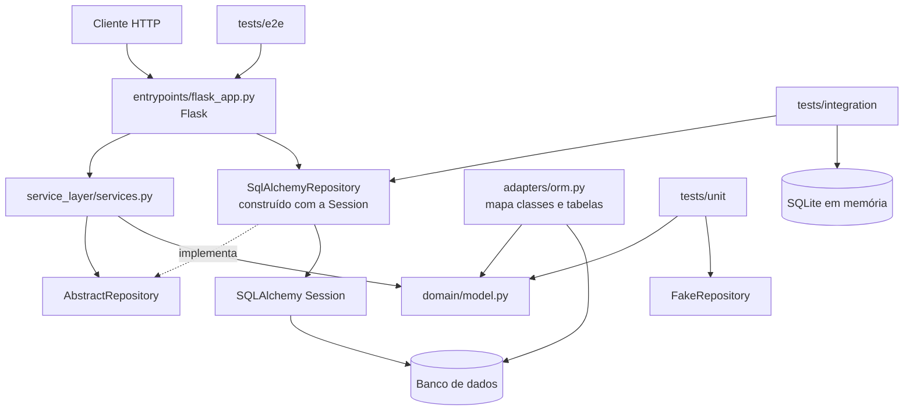

# Arquitetura do sistema Biblioteca

## 1. Escopo

O sistema Biblioteca organiza operações de acervo e exemplares, cadastro de leitores, empréstimos e devoluções, reservas, multas/pagamentos e manutenção/restauro. Os usuários de negócio são os funcionários da biblioteca, que administram o acervo e as operações, e os leitores, cujas operações são representadas no sistema. A aplicação oferece uma API HTTP construída com Flask; a lógica de aplicação é organizada em serviços, os objetos de domínio representam conceitos e comportamentos do negócio, e o acesso persistente é isolado por repositórios apoiados em SQLAlchemy.

## 2. Requisitos arquiteturais

Os atributos abaixo estão priorizados para o domínio e para o escopo atual do projeto. As medidas descritas são critérios verificáveis, não garantias de que todos os cenários já estejam implementados.

### Prioridade 1 — Testabilidade

- **Fonte:** desenvolvedor ou integrante que mantém um agregado.
- **Estímulo:** precisa alterar uma regra de negócio ou adicionar um caso de uso.
- **Ambiente:** desenvolvimento local e integração contínua.
- **Artefato:** entidades de domínio, camada de serviço e repositórios.
- **Resposta esperada:** a regra pode ser testada sem depender de um banco externo; operações de persistência são verificadas separadamente com SQLite; os endpoints são exercitados por testes HTTP.
- **Medida da resposta:** os testes unitários, de integração e E2E são executáveis separadamente e passam na CI. Como evidência de uma execução da CI registrada durante a Fase 1, 7 testes unitários passaram em 0,02 s, 3 testes de integração em 0,36 s e 4 testes E2E em 0,30 s. Esses tempos são de uma execução específica e podem variar entre execuções.

### Prioridade 2 — Modificabilidade

- **Fonte:** desenvolvedor.
- **Estímulo:** precisa adicionar ou alterar uma operação de um agregado.
- **Ambiente:** manutenção evolutiva do sistema.
- **Artefato:** domínio, serviço, repositório e endpoint correspondente.
- **Resposta esperada:** a regra de negócio fica no domínio ou na camada de serviço apropriada; a persistência pode ser alterada no adapter sem obrigar o domínio a importar SQLAlchemy ou Flask.
- **Medida da resposta:** o domínio permanece sem imports de Flask e SQLAlchemy; uma alteração localizada deve afetar somente as camadas relacionadas à operação, com os testes existentes passando. A inclusão de uma operação ainda pode exigir alterações coordenadas no serviço, na rota e nos testes.

### Prioridade 3 — Correção e robustez das operações

- **Fonte:** leitor ou funcionário que envia uma requisição HTTP.
- **Estímulo:** envia dados incompletos ou inválidos, ou solicita uma operação para um item inexistente.
- **Ambiente:** aplicação em execução.
- **Artefato:** endpoint Flask, serviço e repositório.
- **Resposta esperada:** a API rejeita a requisição inadequada com um código HTTP apropriado e não confirma uma operação inválida; para um item não encontrado, retorna 404.
- **Medida da resposta:** testes E2E verificam os códigos HTTP e o resultado retornado. A suíte deve continuar passando após refatorações.

### Restrições e objetivos

- A stack exigida pela disciplina é Python 3, pytest, Flask (ou FastAPI) e SQLAlchemy.
- O sistema deve manter a estrutura em camadas do projeto e a suíte de testes da Fase 1.
- A aplicação precisa suportar os diferentes agregados de negócio do grupo sem duplicar a lógica de domínio nas rotas.
- Os testes de integração utilizam SQLite em memória, o que facilita a execução isolada. Isso não define, por si só, qual banco será usado em uma eventual implantação real.
- Os documentos de arquitetura e os ADRs ficam em `docs/`, em Markdown; os diagramas devem manter fonte em Mermaid ou PlantUML.

## 3. Arquitetura atual

A arquitetura é predominantemente **em camadas**, combinada com o **Repository Pattern**, uma **Service Layer**, mapeamento ORM separado e uma API HTTP baseada em Flask.

- **Domínio — `src/biblioteca/domain/`:** contém as entidades e comportamentos do negócio. Por exemplo, `ItemEmprestado` calcula atraso e registra devolução sem depender diretamente do Flask ou do SQLAlchemy.
- **Adapters — `src/biblioteca/adapters/`:** `orm.py` mantém o mapeamento entre objetos de domínio e tabelas; `repository.py` define `AbstractRepository` e implementações concretas/fakes. O repositório real usa uma sessão SQLAlchemy; o fake mantém os objetos em memória para testes.
- **Camada de serviço — `src/biblioteca/service_layer/`:** orquestra casos de uso e usa a abstração do repositório para buscar e armazenar entidades.
- **Entrypoint — `src/biblioteca/entrypoints/`:** `flask_app.py` recebe requisições HTTP, valida/serializa dados e chama os serviços. No código atual, o entrypoint também cria `SqlAlchemyRepository` usando a sessão recebida, portanto ainda conhece o adapter concreto no ponto de composição.
- **Testes — `tests/unit/`, `tests/integration/` e `tests/e2e/`:** exercitam, respectivamente, domínio/serviços com doubles, persistência com SQLite e a API por meio do cliente de testes Flask.

### Diagrama de componentes e dependências

O diagrama representa os componentes e a direção principal das dependências. O fluxo de integração usa SQLite em memória; a API recebe uma sessão e monta o repositório concreto. `FakeRepository` é usado pelos testes para evitar acesso real ao banco.

## 4. Análise de trade-offs

### Testabilidade

**Benefício:** `FakeRepository` permite testar a camada de serviço sem montar um banco, e os testes de integração verificam a implementação SQLAlchemy separadamente. Os testes E2E conferem o contrato HTTP. Isso reduz o custo de diagnosticar em qual camada ocorreu uma falha.

**Custo:** é preciso manter mais de uma implementação de repositório, configurar os mapeamentos e escrever testes em mais de uma camada. Há mais arquivos e conceitos do que em uma API que consulta o ORM diretamente.

### Modificabilidade

**Benefício:** o domínio é separado do mapeamento ORM e das rotas. Uma alteração na persistência pode ficar no adapter, e os serviços expressam os casos de uso em um ponto distinto da API.

**Custo:** adicionar uma operação frequentemente exige coordenar serviço, endpoint, serialização e testes. Além disso, o entrypoint atual instancia `SqlAlchemyRepository`, o que cria uma dependência concreta no ponto de composição e precisa ser considerada caso existam diferentes configurações de persistência.

### Correção e robustez

**Benefício:** regras como atraso e devolução estão expressas como comportamentos da entidade e podem ser testadas sem a API; os testes E2E verificam os códigos HTTP e respostas.

**Custo/risco:** testes isolados de cada agregado não garantem, sozinhos, invariantes que atravessam agregados. Por exemplo, a regra de bloquear novo empréstimo se um leitor possui devolução em atraso exige que o caso de uso consulte os dados relevantes do leitor e dos empréstimos, em vez de olhar somente um `ItemEmprestado`. A integração desses fluxos precisa ser verificada no sistema completo.

## 5. Alternativa arquitetural: Flask com Active Record

Uma alternativa concreta seria mapear as entidades diretamente como modelos ORM e realizar as operações de persistência e parte da lógica diretamente nas rotas Flask, sem `AbstractRepository` nem uma Service Layer separada. Isso reduz a quantidade de camadas, mas acopla o domínio à tecnologia de persistência e à interface HTTP.

| Atributo | Arquitetura atual: camadas + Repository + Service Layer | Alternativa: Active Record e lógica nas rotas |
|---|---|---|
| Testabilidade | Alta: o fake permite testar serviços sem banco, e SQLite/Flask test client cobrem integração e E2E. | Mais dependente de ORM/sessão e do contexto HTTP; doubles podem ser mais difíceis de substituir. |
| Modificabilidade | Responsabilidades separadas, mas uma operação pode exigir alterações coordenadas em várias camadas. | Menos arquivos no início; com mais regras e agregados, a rota tende a acumular validação, regra e persistência. |
| Simplicidade inicial | Menor simplicidade: há interfaces, adapters, mapeamento explícito e testes de várias camadas. | Maior simplicidade inicial e menos indireção para operações CRUD simples. |
| Correção das regras do domínio | Regras podem ficar no domínio/serviço e ser testadas sem HTTP. | Há risco de regras duplicadas ou aplicadas somente em certos endpoints se ficarem distribuídas pelas rotas. |

### Conclusão

Para a Biblioteca, com vários agregados e regras que podem atravessar empréstimos, leitores, reservas e multas, a arquitetura atual é uma escolha razoável: os limites entre domínio, persistência e HTTP favorecem testes isolados e evolução por módulo. O custo é a maior quantidade de código de ligação e configuração. A recomendação é manter as camadas e o Repository Pattern, mas reduzir o acoplamento do entrypoint com implementações concretas por meio de composição/injeção de dependências bem definida e assegurar que regras entre agregados sejam cobertas por testes de serviço e E2E. A alternativa Active Record pode ser mais simples para um CRUD pequeno, mas é menos atraente para as regras e os módulos deste sistema.

## 6. Evidências do repositório

1. **Custo de acrescentar o módulo de serviço/API de Empréstimo:** o commit `719453d` registrou 7 arquivos alterados, 373 inserções e 1 remoção para incluir serviço, entrypoint e testes relacionados. Isso ilustra que uma operação de ponta a ponta toca mais de uma camada. O commit `4202941` registrou 4 arquivos alterados e 185 inserções ao introduzir o repositório de `ItemEmprestado` e os testes correspondentes.
2. **Separação dos tempos de teste:** em uma execução registrada da CI, passaram 7 testes unitários em 0,02 s, 3 de integração em 0,36 s e 4 E2E em 0,30 s. Esses valores são uma amostra de uma execução do runner, não uma medição estável de desempenho. Eles mostram que os conjuntos são executados e medidos separadamente.
3. **O padrão Repository aparece em mais de um agregado:** o histórico contém o commit `68ead2f` (`feat: implementa padrão repository para o agregado de acervo`) e o commit `4202941` (`feat: implementa repository de ItemEmprestado`). Essa repetição demonstra a reutilização do mesmo estilo arquitetural em módulos diferentes, ao mesmo tempo em que exige manter implementações específicas por agregado.

As evidências acima apoiam a análise de testabilidade, modificabilidade e custo de manutenção; os hashes podem ser consultados com `git show --stat <hash>` no histórico do repositório.
