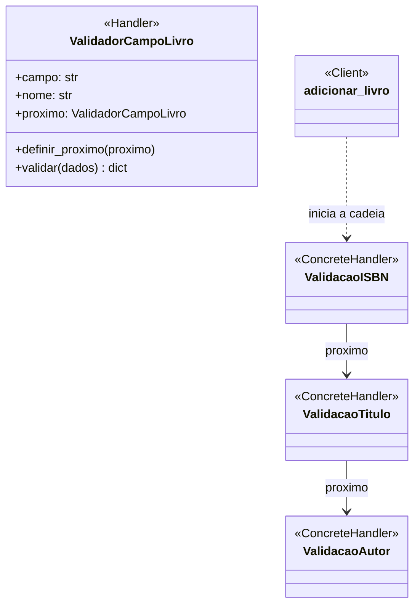
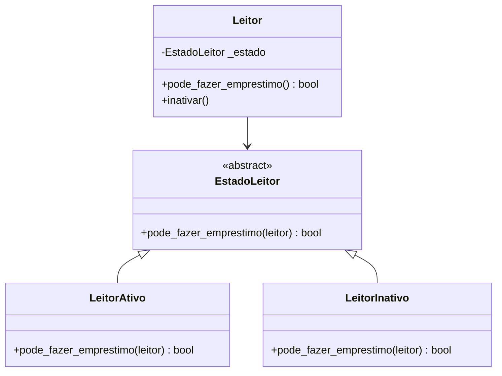
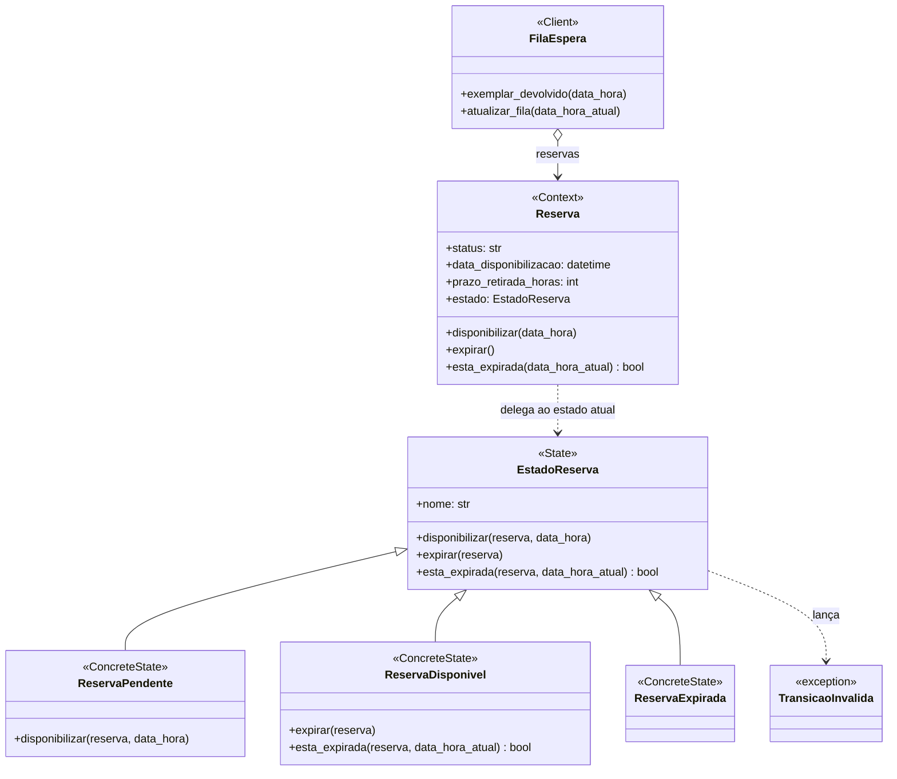
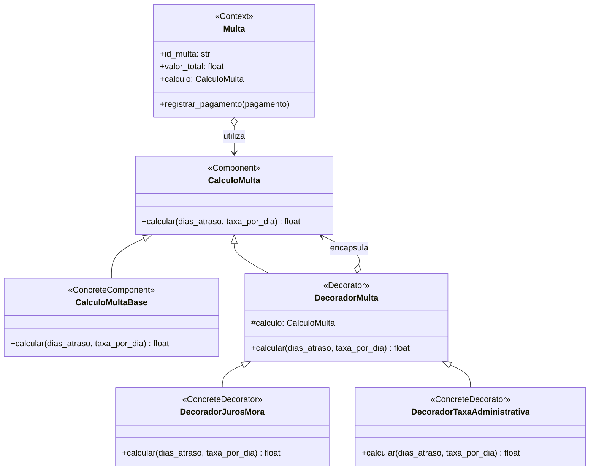

# Padrões GoF — Fase 2

## Lucas Dias Silveira — Acervo

### Padrão e categoria

**Chain of Responsibility** (Cadeia de Responsabilidade)

### Contexto e problema

O caso de uso de cadastro precisa validar ISBN, título e autor antes de criar e
persistir um `Livro`. Fazer as validações diretamente no serviço concentra regras
distintas em um único fluxo e exige modificá-lo sempre que um novo campo obrigatório
for adicionado.

### Aplicação

O serviço `adicionar_livro` envia os dados ao primeiro handler da cadeia. Cada
`ValidadorCampoLivro` valida e normaliza um campo e, se estiver válido, delega os dados
ao próximo handler. Uma entrada inválida interrompe a cadeia com `ValueError`; o livro
só é criado quando todos os handlers terminam.

### Participantes mapeados para o código

| Participante GoF | Classe/função |
|---|---|
| Handler | `ValidadorCampoLivro` |
| ConcreteHandler | Instâncias configuradas para ISBN, título e autor |
| Client | `adicionar_livro` |
| Creator da cadeia | `criar_cadeia_validacao_livro` |

Cada handler é configurado com o nome do campo e a mensagem correspondente. A cadeia
atual valida os três campos nessa ordem; novos validadores podem ser adicionados sem
colocar as regras novamente dentro do serviço.

### Diagrama



`ValidacaoISBN`, `ValidacaoTitulo` e `ValidacaoAutor` no diagrama representam
instâncias de `ValidadorCampoLivro` configuradas para cada campo; não são subclasses.

### Testes

`src/biblioteca/acervo/tests/unit/test_validators.py` verifica que a cadeia normaliza
os três campos e que cada campo vazio interrompe a validação com erro.

## Padrões GoF

### Isabella Vieira da Motta - Padrão State (Comportamental)
* **Agregado:** Leitores
* **Contexto e Problema:** A entidade `Leitor` possuía uma variável booleana `ativo`. O método `pode_fazer_emprestimo()` usava condicionais para barrar o fluxo se o leitor estivesse inativo. Conforme novos status surgissem, esse método se tornaria um aninhamento complexo de IFs.
* **Alternativa Considerada:** Pensei em usar *Strategy*, mas como a mudança de permissão está estritamente ligada ao ciclo de vida e estado interno da entidade (ativo/inativo), o *State* é semanticamente mais adequado.
* **Participantes:**
  * **Context:** `Leitor`
  * **State:** `EstadoLeitor` (Classe abstrata)
  * **Concrete States:** `LeitorAtivo`, `LeitorInativo`
* **Custo/Benefício:** O custo foi o aumento do número de classes no domínio e a necessidade de passar a própria instância do leitor (`self`) para o estado. O benefício é a eliminação de ramificações condicionais, facilitando a adição de novos estados futuros.
* **Testes:** Exercitado no arquivo `test_leitor_state.py`.

* **Diagrama de Classes:**


# Padrões GoF — Fase 2

## João Vicente Piller Menezes — Reserva

### Padrão e categoria

**State** — padrão comportamental.

### Contexto no sistema e problema

Uma `Reserva` passa por um ciclo de vida: começa **Pendente** na fila de espera, fica
**Disponível** quando o exemplar é devolvido e chega a vez do leitor, e torna-se
**Expirada** se o leitor não retirar o exemplar dentro do prazo. Esse ciclo é o centro
da invariante do agregado: o direito de retirada passa para o próximo da `FilaEspera`
quando a reserva expira.

Até a Fase 1, o ciclo era controlado por strings soltas e condicionais espalhadas pela
entidade (código anterior ao commit `00a795e`):

```python
def disponibilizar(self, data_hora: datetime) -> None:
    self.status = "Disponivel"
    self.data_disponibilizacao = data_hora

def esta_expirada(self, data_hora_atual: datetime) -> bool:
    if self.status == "Disponivel" and self.data_disponibilizacao is not None:
        return (data_hora_atual - self.data_disponibilizacao) > timedelta(hours=self.prazo_retirada_horas)
    return False

def expirar(self) -> None:
    self.status = "Expirada"
```

Nenhuma transição era validada, o que gerava problemas reais no domínio:

- uma reserva **expirada** podia ser disponibilizada de novo, devolvendo ao leitor um
  direito que já tinha sido transferido para o próximo da fila;
- uma reserva **disponível** podia ser disponibilizada outra vez, o que **reiniciava o
  prazo de retirada** e dava ao leitor tempo extra indevido;
- uma reserva **pendente** podia ser expirada sem nunca ter ficado disponível.

### Por que State

O comportamento da reserva depende do estado em que ela está, e cada estado aceita
transições diferentes. O padrão State coloca as regras de cada estado em uma classe
própria: a `Reserva` só delega para o estado atual, e as transições proibidas lançam
`TransicaoInvalida` em um único lugar.

Alternativas consideradas:

- **Manter as condicionais na entidade:** bastaria acrescentar `if` para validar cada
  transição, mas cada método passaria a testar todos os estados, e um estado novo
  (por exemplo, "Retirada" ou "Cancelada") obrigaria a revisar todos os métodos.
- **Enum com tabela de transições:** resolveria a validação das transições, mas não o
  comportamento que muda com o estado. O cálculo de expiração, por exemplo, só faz
  sentido para a reserva disponível e continuaria em um `if` dentro da entidade.
- **Strategy:** já foi usado pelo grupo no Empréstimo e serve para trocar um algoritmo
  escolhido de fora. Aqui o comportamento muda sozinho conforme a reserva avança no
  ciclo de vida, que é exatamente o caso do State.

### Participantes mapeados para o código

Todos em `src/biblioteca/reservas/domain/model.py`:

| Participante GoF | Classe no sistema |
|---|---|
| State | `EstadoReserva` |
| ConcreteState | `ReservaPendente` |
| ConcreteState | `ReservaDisponivel` |
| ConcreteState | `ReservaExpirada` |
| Context | `Reserva` |
| Client | `FilaEspera` (`exemplar_devolvido` e `atualizar_fila`) |

`EstadoReserva` define a interface e, por padrão, recusa todas as transições.
`ReservaPendente` só permite `disponibilizar`. `ReservaDisponivel` calcula a expiração
pelo `prazo_retirada_horas` e só permite `expirar`. `ReservaExpirada` é o estado final e
não permite nenhuma transição.

A `Reserva` encontra o estado atual pela propriedade `estado`, que consulta o
dicionário `ESTADOS_RESERVA` a partir do `status` persistido. Com isso, o mapeamento
ORM e a tabela `reservas` não mudaram: a coluna `status` continua guardando o nome do
estado, e uma reserva carregada do banco volta automaticamente ao estado correto.

### Diagrama de classes



### Testes que exercitam o padrão

- `src/biblioteca/reservas/tests/unit/test_estado_reserva.py` (commit `014bb5c`):
  testes de cada estado isolado.
  - `test_estado_pendente_disponibiliza_a_reserva`
  - `test_estado_pendente_nao_pode_expirar`
  - `test_estado_disponivel_expira_apos_o_prazo`
  - `test_estado_disponivel_expira_a_reserva`
  - `test_estado_expirado_nao_permite_nenhuma_transicao`
  - `test_cada_status_tem_um_estado_correspondente`
- `src/biblioteca/reservas/tests/unit/test_reserva.py` (commit `00a795e`): testes da
  `Reserva` delegando ao estado.
  - `test_reserva_expirada_nao_pode_ser_disponibilizada_novamente`
  - `test_reserva_disponivel_nao_reinicia_o_prazo_ao_ser_disponibilizada_de_novo`
  - `test_reserva_pendente_nao_pode_expirar`
  - `test_reserva_delega_o_comportamento_ao_estado_atual`

Os quatro testes de `test_reserva.py` foram executados contra o código anterior ao
padrão e **todos falharam**, o que confirma que os problemas descritos acima existiam.
Depois da aplicação do State, eles passam. Os testes que já existiam antes do padrão
(da fila, do serviço, de integração e e2e) continuaram passando sem alteração, o que
mostra que o fluxo normal da fila de espera foi preservado.

Execução local: `python -m pytest src/biblioteca/reservas -q` → `31 passed`.

### Custo da aplicação do padrão

O padrão acrescenta quatro classes de estado, uma exceção e um dicionário de estados,
além de uma indireção a mais em cada método da `Reserva`. As regras que antes estavam
em três métodos curtos agora ficam distribuídas entre várias classes, o que exige
conhecer o padrão para entender o fluxo.

Também foi preciso manter o `status` como texto para não alterar o banco, de modo que
o nome de cada estado (`nome`) precisa coincidir com o valor persistido. Um teste
(`test_cada_status_tem_um_estado_correspondente`) protege essa correspondência.

O custo compensa porque as transições inválidas, que antes passavam em silêncio,
passaram a ser recusadas pelo domínio, protegendo a invariante de transferência do
direito na fila. Além disso, um estado novo (por exemplo, "Retirada", quando o leitor
busca o exemplar) entra como uma nova classe, sem modificar os estados existentes.

# Padrões GoF - Fase 2

## Ana Laura Neuhaus Vega — Multas

### Padrão e categoria

**Decorator** — padrão estrutural.

### Contexto no sistema e problema

No módulo de Multas, o valor total de uma penalidade é calculado inicialmente a partir dos dias de atraso e da taxa diária. Contudo, dependendo do contexto de cobrança, acréscimos dinâmicos e opcionais podem incidir sobre a multa base — como juros de mora por atrasos prolongados e taxa administrativa fixa de cobrança.

Antes da aplicação do padrão, tentar combinar esses acréscimos dinâmicos gerava rigidez na entidade `Multa`.

### Por que Decorator

O padrão Decorator permite adicionar novas responsabilidades a um objeto dinamicamente encadeando decoradores, sem alterar o código do objeto base nem a estrutura do modelo.

**Alternativas consideradas:**
1. **Herança múltipla / Subclasses concretas:** Criar subclasses como `MultaComJuros`, `MultaComTaxaAdministrativa` e `MultaComJurosETaxa`. Essa abordagem geraria uma explosão combinatória de subclasses a cada nova taxa ou acréscimo criado.
2. **Flags booleanas na entidade `Multa`:** Adicionar parâmetros como `possui_juros: bool` e `possui_taxa: bool` no construtor. Isso violaria o Single Responsibility Principle (SRP) e o Open/Closed Principle (OCP), enchendo o modelo de blocos condicionais `if/else`.

### Participantes mapeados para o código

| Participante GoF | Classe no sistema |
|---|---|
| Component | `CalculoMulta` |
| ConcreteComponent | `CalculoMultaBase` |
| Decorator | `DecoradorMulta` |
| ConcreteDecorator | `DecoradorJurosMora` |
| ConcreteDecorator | `DecoradorTaxaAdministrativa` |
| Context / Client | `Multa` |

### Diagrama de classes



### Testes que exercitam o padrão

- **`test_decorador_juros_mora_aplica_10_porcento_apos_5_dias`:** Exercita o encadeamento simples do `DecoradorJurosMora` sobre a implementação base `CalculoMultaBase`, garantindo a aplicação isolada dos juros de mora sobre atrasos maiores que 5 dias.
- **`test_decoradores_aninhados_juros_e_taxa_administrativa`:** Valida a composição encadeada (*wrapper*) do padrão ao instanciar o `DecoradorTaxaAdministrativa` envolvendo o `DecoradorJurosMora`. O teste assegura que os juros são calculados primeiramente sobre a tarifa base e a taxa fixa de R$ 5,00 é somada ao montante final corretamente.

### Custo da aplicação do padrão

- **Complexidade estrutural:** Introduz uma interface abstrata (`CalculoMulta`), uma classe abstrata decoradora (`DecoradorMulta`) e classes concretas para cada acréscimo financeiro, aumentando o número total de arquivos e classes no módulo.
- **Indireção em tempo de execução:** Cada camada decoradora adiciona uma chamada de método extra na pilha de execução (*delegation stack*) ao calcular o valor total da multa.
- **Instanciação na aplicação:** A montagem dos decoradores requer cuidado na camada de criação/serviço para definir a ordem adequada de empilhamento das taxas.

**Por que compensa:**
O custo compensa amplamente porque separa as regras de encargo financeiro da classe de domínio `Multa`. Permite criar e combinar novos tipos de acréscimos (ex.: multas por reincidência ou descontos pontuais) sem alterar nenhuma linha do código-fonte da entidade `Multa`, mantendo o domínio aderente aos princípios SOLID (SRP e OCP) e sem exigir alterações de schema no banco de dados.