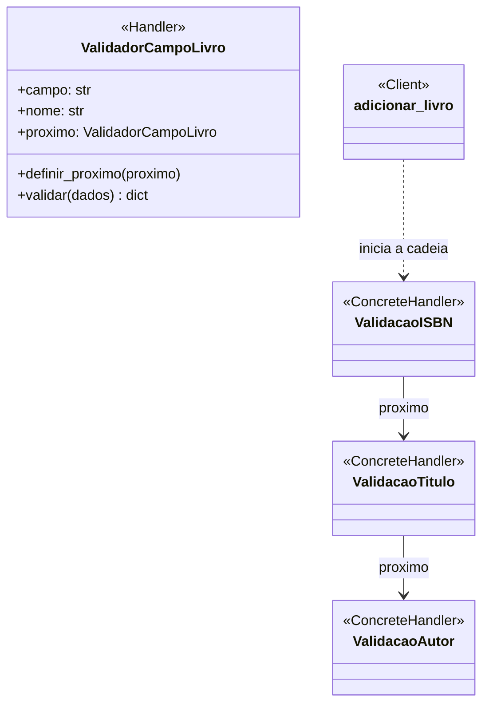

# Padrões GoF — Fase 2

## Lucas Dias Silveira — Acervo

### Padrão e categoria

**Chain of Responsibility** (Cadeia de Responsabilidade)
### Contexto e problema

O caso de uso de cadastro precisa validar ISBN, título e autor antes de criar e
persistir um `Livro`. Fazer as validações diretamente no serviço concentra regras
distintas em um único fluxo e exige modificá-lo sempre que um novo campo obrigatório
for adicionado.

### Aplicação

O serviço `adicionar_livro` envia os dados ao primeiro handler da cadeia. Cada
`ValidadorCampoLivro` valida e normaliza um campo e, se estiver válido, delega os dados
ao próximo handler. Uma entrada inválida interrompe a cadeia com `ValueError`; o livro
só é criado quando todos os handlers terminam.

### Participantes mapeados para o código

| Participante GoF | Classe/função |
|---|---|
| Handler | `ValidadorCampoLivro` |
| ConcreteHandler | Instâncias configuradas para ISBN, título e autor |
| Client | `adicionar_livro` |
| Creator da cadeia | `criar_cadeia_validacao_livro` |

Cada handler é configurado com o nome do campo e a mensagem correspondente. A cadeia
atual valida os três campos nessa ordem; novos validadores podem ser adicionados sem
colocar as regras novamente dentro do serviço.

### Diagrama

`ValidacaoISBN`, `ValidacaoTitulo` e `ValidacaoAutor` no diagrama representam
instâncias de `ValidadorCampoLivro` configuradas para cada campo; não são subclasses.

### Testes

`src/biblioteca/acervo/tests/unit/test_validators.py` verifica que a cadeia normaliza
os três campos e que cada campo vazio interrompe a validação com erro.
