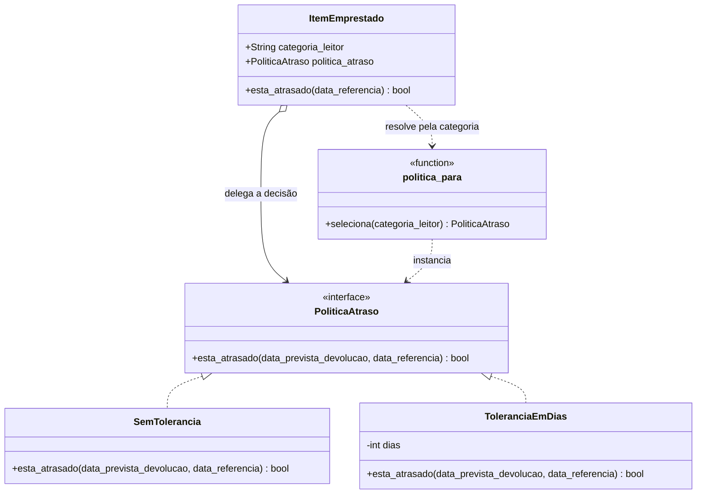

# Padrões GoF — Fase 2

Este documento registra os padrões de projeto GoF aplicados na Fase 2. Cada
integrante documenta o seu próprio padrão, implementado no agregado ou módulo sob sua
responsabilidade. Os padrões devem ser diferentes entre si dentro do grupo.

## Sandy Fortes Cabral — Empréstimo

### Padrão e categoria

**Strategy** — padrão comportamental.

### Contexto no sistema e problema

O agregado `ItemEmprestado` decide se um empréstimo está atrasado comparando a data de
referência com a data prevista de devolução. A regra estava fixa no método
`esta_atrasado`:

```python
def esta_atrasado(self, data_referencia: date) -> bool:
    return (
        self.data_devolucao is None
        and data_referencia > self.data_prevista_devolucao
    )
```

Uma mudança de requisito plausível para a biblioteca é ter tolerância de atraso
diferente por categoria de leitor: alunos têm 1 dia de tolerância, professores têm 3
dias e os demais usuários não têm tolerância. Sem o padrão, cada nova política
exigiria alterar `ItemEmprestado` com mais condicionais, aumentando o risco de quebrar
as regras já existentes.

### Por que Strategy

Strategy permite encapsular cada política de atraso em uma classe própria e trocar a
política usada pelo `ItemEmprestado` sem alterar a entidade. O contexto delega a
decisão para a estratégia, e novas políticas entram como novas subclasses.

Alternativas consideradas:

- **Condicionais dentro de `ItemEmprestado`:** seria mais simples no início, mas
  obrigaria a modificar a entidade a cada categoria ou regra nova, ferindo o
  princípio Aberto/Fechado.
- **Template Method com herança de `ItemEmprestado`:** exigiria uma hierarquia de
  entidades e misturaria a política de atraso com a identidade do empréstimo. Strategy
  mantém a política composível e testável isoladamente.
- **Decorator:** adicionaria comportamento em volta de um item, mas não modela bem a
  substituição de um algoritmo de decisão por outro.

### Participantes mapeados para o código

| Participante GoF | Classe/arquivo no sistema |
|---|---|
| Strategy | `PoliticaAtraso` — `src/biblioteca/emprestimo/domain/politicas.py` |
| ConcreteStrategy | `SemTolerancia` — `politicas.py` |
| ConcreteStrategy | `ToleranciaEmDias` — `politicas.py` |
| Context | `ItemEmprestado` — `src/biblioteca/emprestimo/domain/model.py` |
| Client | `registrar_emprestimo` — `src/biblioteca/emprestimo/service_layer/services.py` |
| Seleção | `politica_para` — `politicas.py` |

`SemTolerancia` preserva o comportamento da Fase 1. `ToleranciaEmDias` recebe a
quantidade de dias e calcula o prazo com tolerância. `politica_para` concentra o
mapeamento de categoria para estratégia (`Aluno` → 1 dia, `Professor` → 3 dias,
demais → sem tolerância), usado tanto pelo serviço na criação quanto pela entidade
ao ser recarregada do banco. Quando nenhuma categoria é informada, usa
`SemTolerancia`, mantendo a API existente compatível.

### Diagrama de classes



### Testes que exercitam o padrão

- `src/biblioteca/emprestimo/tests/unit/test_politica_atraso.py`
  - `test_sem_politica_mantem_comportamento_original`
  - `test_tolerancia_de_um_dia_para_aluno`
  - `test_tolerancia_de_tres_dias_para_professor`
  - `test_politica_pode_ser_trocada_sem_alterar_a_entidade`
  - `test_item_devolvido_nao_fica_atrasado_mesmo_com_tolerancia`
  - `test_tolerancia_negativa_e_rejeitada`
- `src/biblioteca/emprestimo/tests/unit/test_services_emprestimo.py`
  - `test_registrar_emprestimo_seleciona_politica_pela_categoria_do_leitor`
  - `test_registrar_emprestimo_sem_categoria_usa_politica_sem_tolerancia`
- `src/biblioteca/emprestimo/tests/integration/test_emprestimo_orm.py`
  - `test_item_recarregado_do_banco_usa_politica_da_categoria`
- `src/biblioteca/emprestimo/tests/e2e/test_emprestimo_api.py`
  - `test_api_consulta_atraso_usa_tolerancia_da_categoria`
  - `test_api_rejeita_categoria_de_leitor_invalida`

Os testes cobrem as duas estratégias concretas, a troca de estratégia em tempo de
execução, a seleção pela categoria e a rejeição de categoria inválida. O teste de
integração executa `expunge_all()` antes de recarregar o item, garantindo que a
política seja reencontrada a partir da categoria persistida, sem depender do objeto
que ainda está na memória. O teste E2E confirma o mesmo comportamento passando pela
API HTTP.

Execução local: `python -m pytest src/biblioteca/emprestimo/tests -q` → `28 passed`.

### Custo da aplicação do padrão

O padrão adiciona um módulo, uma interface, duas estratégias concretas e uma função de
seleção, além de uma indireção a mais em `esta_atrasado` e de uma coluna nova
(`categoria_leitor`) na tabela `itens_emprestados`. Também é necessário decidir onde a
política é selecionada: nesta implementação, o serviço escolhe a estratégia na criação
e a entidade a reencontra pela categoria quando é recarregada.

Como a categoria é persistida, um item recarregado do banco mantém a tolerância
correta sem reinjeção manual. O que ainda não é configurável é o mapeamento em si:
incluir uma categoria nova com tolerância própria exige acrescentar uma entrada em
`POLITICAS_POR_CATEGORIA`; categorias não mapeadas continuam usando `SemTolerancia`.

O custo compensa porque a regra de atraso deixa de estar presa à entidade e passa a
ser substituível e testável isoladamente. Novas políticas (por exemplo, tolerância em
dias úteis) podem ser adicionadas sem modificar `ItemEmprestado`, e o comportamento
histórico permanece o padrão para não quebrar os testes e a API da Fase 1.
