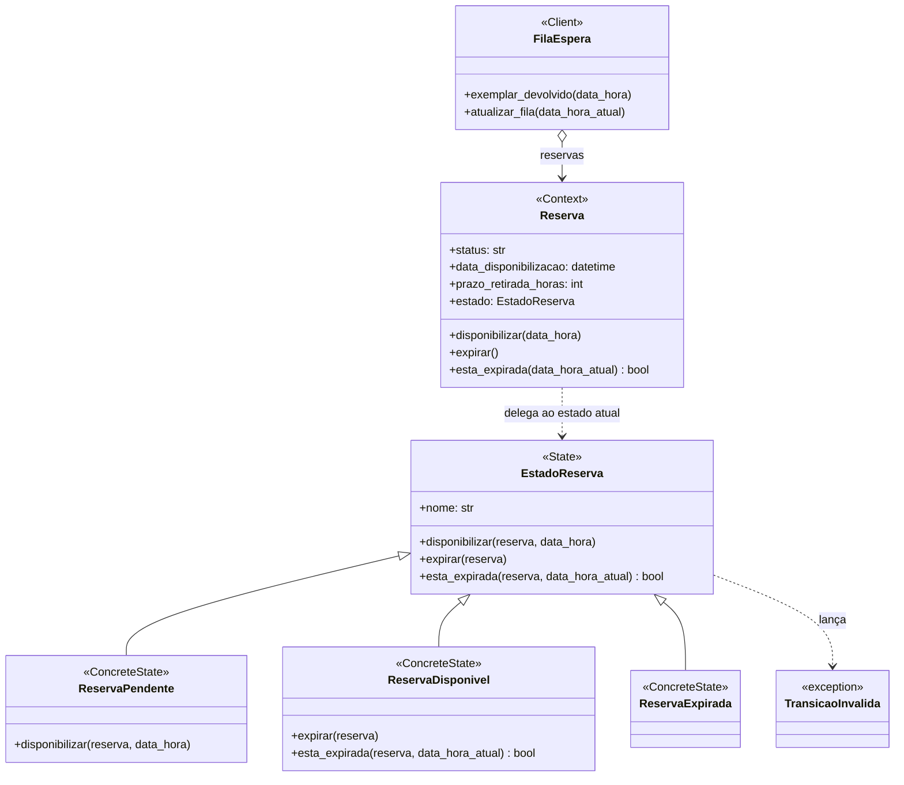

# Padrões GoF — Fase 2

## João Vicente Piller Menezes — Reserva

### Padrão e categoria

**State** — padrão comportamental.

### Contexto no sistema e problema

Uma `Reserva` passa por um ciclo de vida: começa **Pendente** na fila de espera, fica
**Disponível** quando o exemplar é devolvido e chega a vez do leitor, e torna-se
**Expirada** se o leitor não retirar o exemplar dentro do prazo. Esse ciclo é o centro
da invariante do agregado: o direito de retirada passa para o próximo da `FilaEspera`
quando a reserva expira.

Até a Fase 1, o ciclo era controlado por strings soltas e condicionais espalhadas pela
entidade (código anterior ao commit `00a795e`):

```python
def disponibilizar(self, data_hora: datetime) -> None:
    self.status = "Disponivel"
    self.data_disponibilizacao = data_hora

def esta_expirada(self, data_hora_atual: datetime) -> bool:
    if self.status == "Disponivel" and self.data_disponibilizacao is not None:
        return (data_hora_atual - self.data_disponibilizacao) > timedelta(hours=self.prazo_retirada_horas)
    return False

def expirar(self) -> None:
    self.status = "Expirada"
```

Nenhuma transição era validada, o que gerava problemas reais no domínio:

- uma reserva **expirada** podia ser disponibilizada de novo, devolvendo ao leitor um
  direito que já tinha sido transferido para o próximo da fila;
- uma reserva **disponível** podia ser disponibilizada outra vez, o que **reiniciava o
  prazo de retirada** e dava ao leitor tempo extra indevido;
- uma reserva **pendente** podia ser expirada sem nunca ter ficado disponível.

### Por que State

O comportamento da reserva depende do estado em que ela está, e cada estado aceita
transições diferentes. O padrão State coloca as regras de cada estado em uma classe
própria: a `Reserva` só delega para o estado atual, e as transições proibidas lançam
`TransicaoInvalida` em um único lugar.

Alternativas consideradas:

- **Manter as condicionais na entidade:** bastaria acrescentar `if` para validar cada
  transição, mas cada método passaria a testar todos os estados, e um estado novo
  (por exemplo, "Retirada" ou "Cancelada") obrigaria a revisar todos os métodos.
- **Enum com tabela de transições:** resolveria a validação das transições, mas não o
  comportamento que muda com o estado. O cálculo de expiração, por exemplo, só faz
  sentido para a reserva disponível e continuaria em um `if` dentro da entidade.
- **Strategy:** já foi usado pelo grupo no Empréstimo e serve para trocar um algoritmo
  escolhido de fora. Aqui o comportamento muda sozinho conforme a reserva avança no
  ciclo de vida, que é exatamente o caso do State.

### Participantes mapeados para o código

Todos em `src/biblioteca/reservas/domain/model.py`:

| Participante GoF | Classe no sistema |
|---|---|
| State | `EstadoReserva` |
| ConcreteState | `ReservaPendente` |
| ConcreteState | `ReservaDisponivel` |
| ConcreteState | `ReservaExpirada` |
| Context | `Reserva` |
| Client | `FilaEspera` (`exemplar_devolvido` e `atualizar_fila`) |

`EstadoReserva` define a interface e, por padrão, recusa todas as transições.
`ReservaPendente` só permite `disponibilizar`. `ReservaDisponivel` calcula a expiração
pelo `prazo_retirada_horas` e só permite `expirar`. `ReservaExpirada` é o estado final e
não permite nenhuma transição.

A `Reserva` encontra o estado atual pela propriedade `estado`, que consulta o
dicionário `ESTADOS_RESERVA` a partir do `status` persistido. Com isso, o mapeamento
ORM e a tabela `reservas` não mudaram: a coluna `status` continua guardando o nome do
estado, e uma reserva carregada do banco volta automaticamente ao estado correto.

### Diagrama de classes



### Testes que exercitam o padrão

- `src/biblioteca/reservas/tests/unit/test_estado_reserva.py` (commit `014bb5c`):
  testes de cada estado isolado.
  - `test_estado_pendente_disponibiliza_a_reserva`
  - `test_estado_pendente_nao_pode_expirar`
  - `test_estado_disponivel_expira_apos_o_prazo`
  - `test_estado_disponivel_expira_a_reserva`
  - `test_estado_expirado_nao_permite_nenhuma_transicao`
  - `test_cada_status_tem_um_estado_correspondente`
- `src/biblioteca/reservas/tests/unit/test_reserva.py` (commit `00a795e`): testes da
  `Reserva` delegando ao estado.
  - `test_reserva_expirada_nao_pode_ser_disponibilizada_novamente`
  - `test_reserva_disponivel_nao_reinicia_o_prazo_ao_ser_disponibilizada_de_novo`
  - `test_reserva_pendente_nao_pode_expirar`
  - `test_reserva_delega_o_comportamento_ao_estado_atual`

Os quatro testes de `test_reserva.py` foram executados contra o código anterior ao
padrão e **todos falharam**, o que confirma que os problemas descritos acima existiam.
Depois da aplicação do State, eles passam. Os testes que já existiam antes do padrão
(da fila, do serviço, de integração e e2e) continuaram passando sem alteração, o que
mostra que o fluxo normal da fila de espera foi preservado.

Execução local: `python -m pytest src/biblioteca/reservas -q` → `31 passed`.

### Custo da aplicação do padrão

O padrão acrescenta quatro classes de estado, uma exceção e um dicionário de estados,
além de uma indireção a mais em cada método da `Reserva`. As regras que antes estavam
em três métodos curtos agora ficam distribuídas entre várias classes, o que exige
conhecer o padrão para entender o fluxo.

Também foi preciso manter o `status` como texto para não alterar o banco, de modo que
o nome de cada estado (`nome`) precisa coincidir com o valor persistido. Um teste
(`test_cada_status_tem_um_estado_correspondente`) protege essa correspondência.

O custo compensa porque as transições inválidas, que antes passavam em silêncio,
passaram a ser recusadas pelo domínio, protegendo a invariante de transferência do
direito na fila. Além disso, um estado novo (por exemplo, "Retirada", quando o leitor
busca o exemplar) entra como uma nova classe, sem modificar os estados existentes.

## Isabella Vieira da Motta - Padrão Observer (Comportamental)
* **Agregado:** Leitores
* **Contexto e Problema:** Quando um leitor é inativado, vários efeitos colaterais podem ser necessários no futuro (ex: enviar email ao utilizador, gerar log de auditoria, cancelar reservas pendentes automaticamente). Acoplar estas chamadas diretamente no método `inativar()` da entidade violaria o SRP (Princípio de Responsabilidade Única) e o OCP.
* **Solução:** Implementação do padrão *Observer*. A entidade `Leitor` funciona como *Subject/Observable*. Sistemas interessados nesses efeitos colaterais implementam a interface `LeitorObserver` e são notificados no momento da inativação.
* **Participantes:** `Leitor` (Subject), `LeitorObserver` (Observer Abstrato).
* **Custo/Benefício:** O custo é gerir a lista em memória (evitando que o SQLAlchemy tente persistir a lista de observers no banco de dados, resolvido via `@property`). O benefício é manter a entidade de domínio limpa e extensível sem alteração de código.
* **Diagrama de Classes:**
```mermaid
classDiagram
    class Leitor {
        -List~LeitorObserver~ _observers
        +adicionar_observer(LeitorObserver)
        +inativar()
    }
    class LeitorObserver {
        <<abstract>>
        +leitor_inativado(Leitor)
    }
    class MockEmailObserver {
        +leitor_inativado(Leitor)
    }
    Leitor --> LeitorObserver : notifica
    LeitorObserver <|-- MockEmailObserver